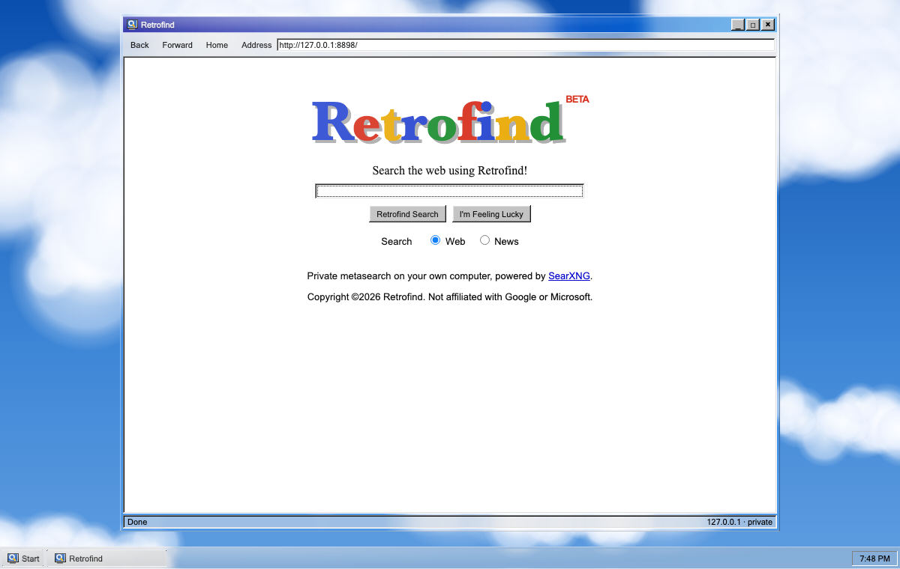
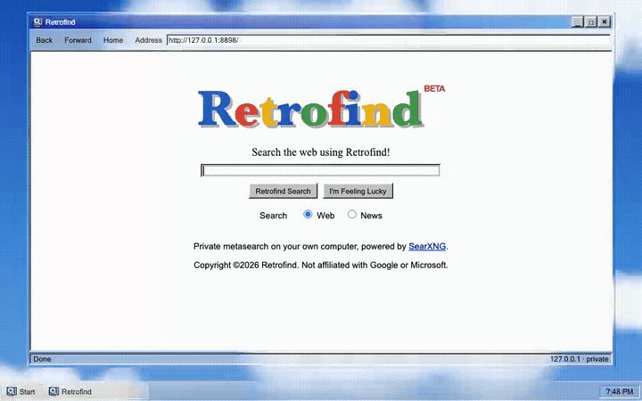
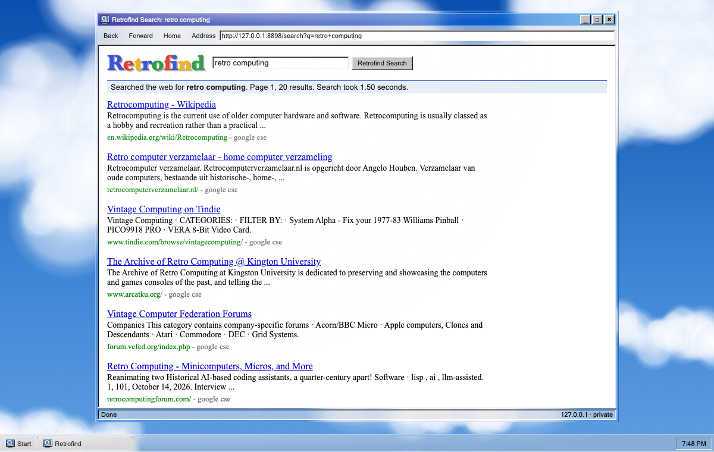

<div align="center">


# Retrofind

Private web search on your own Mac, in the style of 1998. Underneath, [SearXNG](https://github.com/searxng/searxng) runs without Docker. On top sits a start page modelled on early Google, in a Windows 98 window made of liquid glass.

[Install](#install) · [How it works](#how-it-works) · [Contributing](CONTRIBUTING.md)

[](LICENSE)




</div>

<!-- live-links -->
**Live:** [gitguy268.github.io/retrofind](https://gitguy268.github.io/retrofind/) · [retrofind.vercel.app](https://retrofind.vercel.app)
<!-- /live-links -->

## Install with Homebrew

```sh
brew trust gitguy268/tap
brew install gitguy268/tap/retrofind
```

Then run `retrofind`: the first run installs SearXNG and opens <http://127.0.0.1:8898/>. Run `retrofind uninstall` before `brew uninstall retrofind`.

<!-- run-steps:start -->
## Run it locally, step by step

1. **Install [Homebrew](https://brew.sh)** (macOS), then uv:

   ```sh
   brew install uv
   ```

2. **Get the code:**

   ```sh
   git clone https://github.com/Gitguy268/retrofind.git
   cd retrofind
   ```

3. **Start it** by double-clicking `start.command`. The first run installs SearXNG, which takes a few minutes.

4. **Open <http://127.0.0.1:8898/>** in your browser. Both services start again when you log in; see the uninstall notes below to remove them.
<!-- run-steps:end -->

## Features

- **Local search.** SearXNG asks several search engines at once and runs on `127.0.0.1`, so no single search company sees your searches.
- **No Docker.** A Python virtual environment, made with `uv`, kept running by two macOS LaunchAgents.
- **1998 start page.** A wordmark with drop shadow, "I'm Feeling Lucky", and a Web or News choice.
- **1998 results page.** A blue "Searched the web for…" bar, green URLs, and a "Retroooofind" page strip.
- **Liquid glass.** The window frame, title bar, taskbar and Start button refract the sky behind them. Results stay on solid white, so they are easy to read.
- **Safe results.** Only `http` and `https` links reach the page, and results are inserted as text, never as HTML.



## Install

You need macOS and [Homebrew](https://brew.sh).

1. **Get the code.** Clone this repository, then install uv:
   ```sh
   brew install uv
   ```
2. **Double-click `start.command`.** The first run installs SearXNG (a few minutes). After that it starts Retrofind and opens <http://127.0.0.1:8898/>.

Both services start again when you log in. To make Retrofind your browser's search engine, add a site search with this URL:

```
http://127.0.0.1:8898/search?q=%s
```

<details>
<summary>Install from the terminal, ports, uninstall</summary>

```sh
sh searxng/install.sh     # install or update, then start both services
sh searxng/uninstall.sh   # stop both and delete everything install.sh made
```

| What | Where |
|---|---|
| Retrofind page | `127.0.0.1:8898`, or set `RETROFIND_PORT` |
| SearXNG | `127.0.0.1:8893`, or set `RETROFIND_SEARXNG_PORT` |
| SearXNG code, venv, `settings.yml` | `~/Library/Application Support/Retrofind/searxng` |
| Logs | `~/Library/Logs/Retrofind` |
| LaunchAgents | `org.retrofind.searxng`, `org.retrofind.web` |

`settings.yml` holds a secret generated on your Mac. It never enters this repository. Edit that file to switch search engines on or off, then run the installer again to restart.

`server.py` runs from the folder you cloned. If you move the folder, double-click `start.command` again.

</details>

## How it works

```
browser ──► server.py (127.0.0.1:8898) ──► SearXNG (127.0.0.1:8893) ──► search engines
             pages + /api/search            JSON API, unmodified
```

- `web/` is plain HTML, CSS and JavaScript, with no build step.
- `server.py` uses only Python's standard library. It serves `web/` and passes exactly three things to SearXNG: the query, the page number and the category. It also strips every result down to its title, link, snippet and engine names.
- SearXNG is AGPL-3.0. Retrofind does not include or change it: `searxng/install.sh` downloads a pinned version and runs it as a separate program.

<details>
<summary>Limits</summary>

- **No result totals.** SearXNG doesn't report how many results exist, so the results bar shows the page number, not "of about N".
- **No image search.** It was left out on purpose: 1998 had none, and the thumbnails would load from third-party servers.
- **Engines can be blocked.** Some engines block or rate-limit your IP from time to time (Brave and DuckDuckGo did while this was built), so results can come from fewer engines.
- **Liquid glass is Chromium only.** The bending glass works in Chromium browsers (Brave, Chrome, Edge, Helium). Safari and Firefox get see-through glass that does not bend. "Reduce transparency" in macOS gives solid Win98 grey.
- **macOS only.** The installer uses LaunchAgents.

</details>



## Contributing

See [CONTRIBUTING.md](CONTRIBUTING.md). Report security problems privately, as described in [SECURITY.md](SECURITY.md).

## Licence

[MIT](LICENSE) © 2026 Lucas Van De Weerd. Third-party code and credits are listed in [NOTICE](NOTICE). Retrofind is not affiliated with Google or Microsoft.
